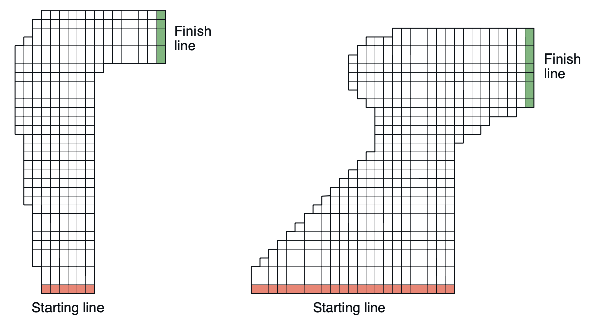

# Práctica 2. Investigación Operativa

**Asignatura:** Investigación Operativa  
**Curso:** 2026-2027  
**Fuente:** Carlos Quesada González, *Investigación Operativa*, tema 5: «Prácticas», páginas 99-101 (páginas 102-104 del PDF).

## Indicaciones generales

Todas las prácticas se realizan en grupos de hasta 4 personas, conforme a la herramienta de elección de grupos de Moodle.

Esta práctica consta de dos partes que deben ser entregadas, **como tarde, el día del examen final**. Se recomienda encarecidamente entregar la práctica **al menos una semana antes de la fecha límite**. De esa forma habrá posibilidad de que recibáis feedback para corregir lo que fuera necesario. En caso de entregarlo en la fecha límite, esa versión se considerará definitiva.

Se recuerda que el uso de herramientas de IA está permitido, pero **todo el código debe estar comentado en castellano, explicando qué hace**. Además, todos los grupos deberán defender esta práctica el día **[pendiente de acordar con vosotros]**. La nota de esta práctica saldrá de la evaluación conjunta de lo entregado y lo expuesto y podrá ser diferente para integrantes de un mismo grupo, si su desempeño en la exposición también lo es.

### Detalles sobre la exposición

- La presentación debe realizarse utilizando PowerPoint o un programa similar de presentación de diapositivas.
- En la presentación se expondrán **ambas partes**, cada una deberá ser la mitad de la presentación. Se deberá dedicar especial atención a explicar problemas que se han ido encontrando al implementar ambas partes de la práctica, así como la toma de decisiones.
- La presentación debe constar de un **máximo de 10 diapositivas** (la portada y contraportada no cuentan).
- La presentación debe durar **exactamente 10 minutos** (en concreto, desfases de más de un minuto serán penalizados).
- Cada diapositiva debe contener, como mucho, **50 palabras**.
- Cada diapositiva debe contener un **máximo de dos líneas de código, o 5 líneas de pseudocódigo**.
- Cada mención que permita identificar que el trabajo se ha dividido penalizará, por ejemplo «en la parte de compañero1...», «el código de compañero3...», «en lo que hizo compañero2...». (El trabajo se puede dividir, pero yo no me puedo enterar: hay que llegar a la presentación como una unidad).
- No se permite leer la exposición.

## Parte 1 (50% de la nota de la Práctica 2)

Programa la resolución del **Ejercicio 5.12 de [21]**, que dice:

Considera conducir un coche de carreras alrededor de una curva, como las mostradas en la siguiente figura.

Quieres ir lo más rápido posible, pero no tan rápido como para salirte de la pista. En nuestro circuito simplificado, el coche está en una de un conjunto discreto de posiciones en una cuadrícula, representadas por las celdas del diagrama. La velocidad también es discreta, definida como el número de celdas de la cuadrícula que el coche se desplaza horizontal y verticalmente en cada paso de tiempo.

Las acciones son incrementos en los componentes de velocidad. Cada uno de estos componentes puede cambiar en +1, -1 o 0 en cada paso, para un total de nueve acciones posibles (3 × 3). Ambos componentes de velocidad están restringidos a ser no negativos y menores que 5, y no pueden ser simultáneamente cero excepto en la línea de salida.

Cada episodio comienza en uno de los estados iniciales seleccionados aleatoriamente, con ambos componentes de velocidad igual a cero, y termina cuando el coche cruza la línea de meta. Se otorgan recompensas de -1 por cada paso hasta que el coche cruza la línea de meta. Si el coche golpea el límite de la pista, se mueve de vuelta a una posición aleatoria en la línea de salida, ambos componentes de velocidad se reducen a cero y el episodio continúa.

Antes de actualizar la ubicación del coche en cada paso de tiempo, se verifica si la trayectoria proyectada del coche interseca el límite de la pista. Si interseca la línea de meta, el episodio termina; si interseca cualquier otra parte, se considera que el coche ha golpeado el límite de la pista y se lo regresa a la línea de salida.

Aplica un **método de control Monte Carlo** a esta tarea para calcular la política óptima desde cada estado inicial. Muestra varias trayectorias siguiendo la política óptima.

Encuentra alguna forma de hacer algún tipo de **representación gráfica** de esto, ya sea con imágenes estáticas o animaciones.

## Parte 2 (50% de la nota de la Práctica 2)

Crea un **morphing entre dos imágenes de las caras de dos de los miembros del grupo**¹. Necesitaréis considerar muchos detalles que no hemos tratado en clase, porque en pizarra era imposible hacer todos estos cálculos.

- **Entradas y salidas:** ¿Qué formatos, tamaños y tipos de datos espera el script que creéis?
- **Preprocesamiento:** ¿Qué pasos de preprocesado se aplican antes del morphing y por qué ese orden es importante?
- **Algoritmo principal:** ¿Qué método concreto usaréis y por qué se eligió? (Recomendación: Informáos sobre el algortimo de Sinkhorn).
- **Parámetros y decisiones de diseño:** ¿Qué parámetros controlan el resultado (según lo que programéis pueden ser algunos de nº de frames/interpolación, regularización, kernel de suavizado, umbrales) y cómo afectan al resultado final? ¿Cómo se seleccionaron sus valores por defecto?

¹ Si alguien tiene problema con compartir una foto propia, por supuesto el ejercicio puede realizarse con caras encontradas por internet, pero me parece más divertido hacerlo con vosotros mismos.

---

**Referencia [21]:** R. S. Sutton y A. G. Barto, *Reinforcement Learning: An Introduction*, 2.ª edición, MIT Press, 2018.
